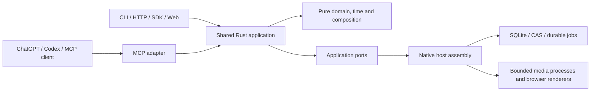

# OpenCut Plugin

[English](README.md) | [简体中文](README.zh-CN.md)

Local video editing for ChatGPT/Codex and other MCP clients, backed by a shared Rust engine, CLI, HTTP service and Web workbench.

**Development prerelease.** The first downloadable runtime targets **macOS Intel (`x86_64`)**. Apple Silicon, Windows and Linux release packages are not yet qualified. The plugin format does not impose a permanent OS restriction. This project is distributed through GitHub, not the official OpenAI plugin directory.

## Relationship to OpenCut

OpenCut Plugin is a community fork derived from [OpenCut](https://github.com/OpenCut-app/OpenCut), maintained independently by [miracle-ai-studio](https://github.com/miracle-ai-studio). It is not an official OpenCut release and is not affiliated with or endorsed by the upstream maintainers.

This fork adds a Rust application/contract layer and agent-oriented CLI, HTTP, MCP and SDK adapters. It retains selected Classic rendering behavior, shaders, font metadata and licensed dependencies with their recorded provenance. Its project formats and feature coverage should not be assumed identical to the upstream editor. The engine executable and public operation names remain `opencut` / `opencut_*` for compatibility. Upstream copyright notices remain intact; see [LICENSE](LICENSE) and the bundled third-party notices. Individual dependencies retain their own licenses, including LGPL components.

## What it does

- Inspect projects, fixed revisions, media, timelines and available runtime capabilities.
- Plan and atomically apply timeline edits, undo/redo, text, subtitles, graphics, masks, transitions and audio adjustments.
- Choose a project cover from a source-video frame or an imported image.
- Run source analysis and optional local transcription; manage previews, renders, jobs, cancellation and published artifacts.
- Exchange project packages, retain revision history and enforce resource permissions.
- Use the Web workbench for direct editing and inspection.

The external agent interprets creative requests. OpenCut executes typed operations; it does not bundle an LLM, promise automatic editorial quality, or treat an accepted render job as a completed export.

## Interface screenshots

### English


User-supplied Chinese workbench capture.

## Install on macOS

The current `0.0.1-beta` package requires **macOS 26 or later on an Intel Mac**. Apple Silicon validation is deferred.

### Install for Codex

After the [GitHub prerelease](https://github.com/miracle-ai-studio/OpenCut-Plugin/releases/tag/v0.0.1-beta) is public, paste this block into Terminal on an Intel Mac running macOS 26 or later with the Codex CLI installed. You can also ask a local Codex session to run it.

```sh
(
  installer=$(mktemp) && trap 'rm -f "$installer"' EXIT &&
  curl -fsSL https://github.com/miracle-ai-studio/OpenCut-Plugin/releases/download/v0.0.1-beta/install-desktop.sh -o "$installer" &&
  sh "$installer" install v0.0.1-beta --codex-plugin
)
```

The script verifies the platform package, starts the local service, registers MCP and enables **OpenCut Plugin**. Open a new local Codex conversation, select **OpenCut Plugin**, and ask it to list your OpenCut projects.

### Install the desktop app

Download the `OpenCut-<version>-<chip>.zip` that matches your Mac, unzip it, and double-click `OpenCut.app`. Choose **Install Desktop App** to place the branded app in `~/Applications`, then **Install / Start** and **Open Editor**. The app installs its bundled runtime, starts the local service, and registers `opencut_desktop` when Codex is installed. Existing installations can use **Switch to Standard Workspace** to select the existing `~/.opencut/workspace.sqlite` database. Projects in the previous workspace remain there and its database is kept. The window displays the current Metal device status. To upgrade a running service, choose **Stop Service** before **Install / Start**. A public download with only local ad-hoc signing may require a manual macOS trust decision; a Developer ID signed and notarized release requires an Apple Developer account.

After installation, opening OpenCut starts a stopped service automatically and reuses a ready service. **Install Desktop App** also replaces an existing OpenCut app of the same or an older version after checking the staged copy. The MCP entry is `opencut_desktop`, using stdio with the fixed executable `~/.opencut-plugin/opencut-mcp` and no arguments or environment variables. Open OpenCut before connecting your MCP client.

You can also install from a downloaded platform ZIP with its `.sha256` file beside it. From a source checkout, use `scripts/install-desktop.sh` in place of `install-desktop.sh`.

```sh
sh install-desktop.sh install --archive /path/to/opencut-release.zip
```

Open the `web_url` in the installer output. To edit with an agent, open a new local Codex session and ask it to list your OpenCut projects. New installs use `~/.opencut/workspace.sqlite`. Upgrades keep the selected workspace.

## Manage your installation

| Command | Purpose |
|---|---|
| `sh install-desktop.sh start` | Start the workbench and print its URL |
| `sh install-desktop.sh check` | Check the service, project list, and Codex MCP registration |
| `sh install-desktop.sh doctor` | Verify runtime integrity, architecture, and basic dependencies |
| `sh install-desktop.sh stop` | Stop the local service |
| `sh install-desktop.sh update v0.0.1-beta` | Install the selected version and start the service again |

Finish active jobs and run `stop` before updating. `update --archive /path/to/opencut-release.zip` upgrades from a local ZIP. Run `check` after updating to verify the connection. [Operations guide](docs/operations.md)

## MCP and CLI capabilities

The current shared registry declares **185 named operations in 12 logical domains**. Default MCP discovery groups operations into domain tools; the administrative `workspace` domain is not included in the compact default list. `--tool-surface legacy` exposes the existing named operation surface. Both resolve to the same Rust application operations and permission checks.

| Domain | Current capability |
|---|---|
| `system` | Runtime capabilities and availability |
| `project` | Create/list/inspect, fixed revisions, timeline queries, history, branches and project packages |
| `edit` | Plans and atomic commits, undo/redo, timeline/geometry/keyframes, text/subtitles, graphics, masks and audio |
| `media` | Upload sessions, import plans, media inspection/repair/removal, thumbnails and display waveforms |
| `analysis` | Content search, shots/silence/waveforms, evidence and optional transcription/speaker turns |
| `render` | Preflight, visual/audio previews, render submission and quality evidence |
| `catalog` | Licensed font/brand/resource discovery and explicitly permitted imports |
| `task` | Job views, queries, changes, receipts, submission and cancellation requests |
| `observe` | Authorized artifact/resource retrieval, event changes and audit queries |
| `plugin` | OpenCut engine extension packages, presets and permission grants; distinct from ChatGPT plugin installation |
| `access` | Local caller access and permission management |
| `workspace` | Administrative storage, budget, worker and recovery controls; inspect schemas and permissions first |

[Complete operation inventory](https://github.com/miracle-ai-studio/OpenCut-Plugin/blob/main/docs/cli-mcp-capabilities.md) is generated from the same declared schemas. Optional providers, font downloads and transcription are usable only when configured and authorized. Large byte transfers use the dedicated upload/download transport or CLI commands, not arbitrary base64 blobs in MCP arguments.

```sh
opencut --json system capabilities
opencut --json system domains --domain edit --schemas
opencut --database /absolute/path/to/workspace.sqlite --json project list
opencut --database /absolute/path/to/workspace.sqlite mcp serve --with-worker
```

Use the installed executable path printed by the installer, or add its directory to your PATH. CLI `call <operation> --input request.json` and `domain <domain> <action> --input request.json` share semantics with MCP. For example, `opencut_edit` accepts `{"action":"plan","input":...}`; named tools expose `opencut_edit_plan`. Writes retain the fixed revision, original request and idempotency key.

## Design



Business operations have one implementation. Adapters preserve exact rational time, fixed revisions, atomic commits, authorization, cancellation and publication fences. The plugin launcher only assembles process configuration; it does not recreate editing rules or use the CLI as internal application RPC.

[Architecture](https://github.com/miracle-ai-studio/OpenCut-Plugin/blob/main/docs/architecture.md) · [Contracts](https://github.com/miracle-ai-studio/OpenCut-Plugin/blob/main/docs/contracts.md) · [Runtime configuration](https://github.com/miracle-ai-studio/OpenCut-Plugin/blob/main/docs/operations.md) · [Development](https://github.com/miracle-ai-studio/OpenCut-Plugin/blob/main/docs/development.md)

## Build from source

Install rustup, Node.js 22.12+ and Python 3.11+. Rust is pinned by `rust-toolchain.toml`. Native builds additionally require the reviewed FFmpeg shared-library inputs described in [development](https://github.com/miracle-ai-studio/OpenCut-Plugin/blob/main/docs/development.md).

```sh
npm ci --prefix packages/sdk-ts
npm ci --prefix apps/web
# Set PKG_CONFIG_PATH to the reviewed native media library installation.
RUSTFLAGS="--remap-path-prefix=$HOME=/opencut/build" cargo build --locked --release -p opencut-cli -p opencut-render-worker
npm run build --prefix apps/web
```

Assemble the native runtime and pinned tools with `scripts/package-local.py` as described in [development](https://github.com/miracle-ai-studio/OpenCut-Plugin/blob/main/docs/development.md). The source launcher requires that assembled runtime's manifest; pass its `bin/opencut`, not an unassembled Cargo executable. Packaging, generated contracts, installation and renderer acceptance must all identify the delivered files.

## Data, updates and limitations

Media processing and workspace storage are local. MCP responses and resources explicitly returned to a connected agent enter that host's context; do not assume that local processing prevents every metadata or preview disclosure. Optional outbound resource providers require their existing configuration and permissions. The installer does not grant remote access or expose a public server.

Runtime versions are installed separately from workspace data. Stop active clients/jobs before removing a runtime. `codex plugin remove opencut@opencut-plugin` removes the client plugin; it does not delete project data. Preserve the workspace database and associated CAS/media when backing up or migrating. Optional downloads and font caches are not part of the GitHub package.

This is an unsigned development prerelease. Gatekeeper/notarization, clean-machine and cross-platform acceptance, full independent pixel/PCM equivalence, long-media resource limits and physical audio/IME/Finder interactions are not fully qualified. Read [delivery status](https://github.com/miracle-ai-studio/OpenCut-Plugin/blob/main/docs/status.md) and the release verification report for the exact tested scope. The earlier browser-runtime release failed its unchanged synthetic red-pixel gate. Its evidence does not qualify this native package; use the verification report attached to this release for the actual installed producer and result. The initial export check exposed automatic output reservations starving database heartbeat headroom; reservation calculation now retains control space and accounts for actual file growth. Explicit workspace quotas remain effective. No GitHub Actions pipelines are included.

## Keywords

`opencut` · `video-editing` · `video-editor` · `mcp` · `mcp-server` · `model-context-protocol` · `chatgpt` · `chatgpt-plugin` · `codex` · `codex-plugin` · `cli` · `rust` · `local-first` · `open-source` · `plugin`
