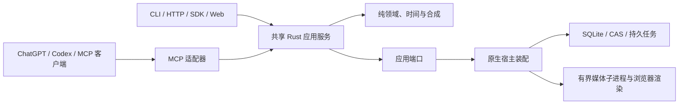

# OpenCut Plugin

[English](README.md) | [简体中文](README.zh-CN.md)

面向 ChatGPT/Codex 等 MCP 客户端的本地视频剪辑插件，共用 Rust 引擎、CLI、HTTP 服务、SDK 与 Web 工作台。

**当前为开发预发布版。** 首个下载运行包面向 **macOS Intel（`x86_64`）**；Apple Silicon、Windows 和 Linux 的发行包尚未完成验证。插件格式本身不锁定操作系统。本项目通过 GitHub 分发，暂不上架 OpenAI 官方插件目录。

## 与 OpenCut 的关系

OpenCut Plugin 是基于 [OpenCut](https://github.com/OpenCut-app/OpenCut) 衍生的社区分支，由 [miracle-ai-studio](https://github.com/miracle-ai-studio) 独立维护。它不是 OpenCut 官方发行版，与上游维护团队没有隶属或背书关系。

本分支新增 Rust 应用/契约层，以及面向 Agent 的 CLI、HTTP、MCP、SDK 接口；保留部分 Classic 渲染行为、着色器、字体元数据和依赖，并记录许可及来源。不应假设本分支的工程格式和功能与上游完全一致。为保持兼容，可执行程序和公开操作仍使用 `opencut` / `opencut_*` 名称。原有版权声明保留，见 [LICENSE](LICENSE) 和运行包中的第三方声明；LGPL 等第三方组件继续适用各自许可。

## 当前功能

- 查询工程、固定修订、素材、时间线和运行环境能力。
- 规划并原子提交剪辑，支持撤销/重做、文字字幕、图形、蒙版、转场与音频调整。
- 从源视频选择帧或导入图片作为工程封面。
- 执行素材分析、可选本地转写，管理预览、渲染、任务取消和发布产物。
- 交换工程包，保留历史与资源权限。
- 使用 Web 工作台直接剪辑和检查。

外部 Agent 负责理解创作要求，OpenCut 执行类型化操作。本项目不内置大模型，不承诺自动达到特定审片质量；任务已提交也不代表导出成功。

## 界面截图

### 中文界面


用户提供的中文工作台截图。

## 安装到 macOS

当前 `0.0.1-beta` 安装包要求 **Intel Mac 和 macOS 26 或更新版本**。Apple Silicon 验证暂缓。

### 一键安装到 Codex

[GitHub 预发行版](https://github.com/miracle-ai-studio/OpenCut-Plugin/releases/tag/v0.0.1-beta)公开后，在已安装 Codex CLI、运行 macOS 26 或更新版本的 Intel Mac 上，把下面整段粘贴到终端执行，也可以让本地 Codex 会话执行。

```sh
(
  installer=$(mktemp) && trap 'rm -f "$installer"' EXIT &&
  curl -fsSL https://github.com/miracle-ai-studio/OpenCut-Plugin/releases/download/v0.0.1-beta/install-desktop.sh -o "$installer" &&
  sh "$installer" install v0.0.1-beta --codex-plugin
)
```

脚本会校验平台包、启动本地服务、注册 MCP 并启用 **OpenCut Plugin**。安装后新开一个本地 Codex 对话，选择 **OpenCut Plugin**，让它列出 OpenCut 工程。

### 安装桌面应用

下载与你的 Mac 芯片相符的 `OpenCut-<版本>-<芯片>.zip`，解压后双击 `OpenCut.app`。点击“安装桌面应用”可将带 OpenCut 图标的应用放入 `~/Applications`，然后点击“安装 / 启动”和“打开编辑器”。应用会安装包内运行时、启动本机服务；本机已有 Codex 时会注册 `opencut_desktop`。旧安装可点击“切换标准工作区”，选用现有的 `~/.opencut/workspace.sqlite` 数据库；旧工作区的工程留在原数据库，数据库文件会保留。窗口会显示 Metal 设备状态。升级正在运行的服务时，先点“停止服务”再点“安装 / 启动”。仅经过本地 ad-hoc 签名的网上下载版本可能需要在 macOS 中手动确认信任；使用 Developer ID 签名并公证的发行版需要 Apple 开发者账号。

安装完成后，打开 OpenCut 会自动启动已停止的服务，已就绪的服务会直接复用。“安装桌面应用”也支持替换同版本或更旧的 OpenCut，先校验新副本再替换。MCP 名称为 `opencut_desktop`，使用 stdio，固定启动命令为 `~/.opencut-plugin/opencut-mcp`，无需参数或环境变量。连接 MCP 客户端前先打开 OpenCut。

也可用已下载的平台 ZIP 离线安装，请把 `.sha256` 放在同一目录。从源码目录操作时，将命令里的 `install-desktop.sh` 换成 `scripts/install-desktop.sh`。

```sh
sh install-desktop.sh install --archive /path/to/opencut-release.zip
```

打开安装结果里的 `web_url` 进入工作台。要让 Agent 剪辑，打开新的本地 Codex 会话，让它列出 OpenCut 工程。首次安装使用 `~/.opencut/workspace.sqlite`，升级沿用已有工作区。

## 管理本机安装

| 命令 | 用途 |
|---|---|
| `sh install-desktop.sh start` | 启动工作台并返回访问地址 |
| `sh install-desktop.sh check` | 检查服务、工程列表和 Codex MCP 注册 |
| `sh install-desktop.sh doctor` | 检查运行时完整性、芯片架构和基础依赖 |
| `sh install-desktop.sh stop` | 停止本机服务 |
| `sh install-desktop.sh update v0.0.1-beta` | 升级到指定版本并重新启动服务 |

升级前等任务完成，再执行 `stop`。使用 `update --archive /path/to/opencut-release.zip` 可以从本地 ZIP 升级。升级完成后运行 `check` 验证连接。[运行手册](docs/operations.md)

## MCP / CLI 当前能力

同一份 Rust 注册表声明 **185 个具名操作、12 个逻辑领域**。MCP 默认按领域聚合工具；管理用 `workspace` 领域不进入默认紧凑列表。`--tool-surface legacy` 可以展开已有具名操作，业务实现和权限检查仍是同一套。

| 领域 | 已实现范围 |
|---|---|
| `system` | 运行能力与可用性查询 |
| `project` | 新建/查询、固定修订、时间线区间、历史、分支与工程包 |
| `edit` | 规划和原子提交、撤销重做、时间线/几何/关键帧、文字字幕、图形蒙版与音频 |
| `media` | 上传会话、导入规划、素材检查修复删除、缩略图与显示波形 |
| `analysis` | 内容检索、镜头/静音/波形、证据、可选转写与说话轮次 |
| `render` | 预检、视音频预览、渲染提交与质量证据 |
| `catalog` | 授权字体、品牌与资源目录，以及明确获准的导入 |
| `task` | 任务视图、查询、变化、回执、提交与取消请求 |
| `observe` | 授权产物/资源读取、事件变化与审计查询 |
| `plugin` | OpenCut 引擎扩展包、预设与授权，不等于 ChatGPT 插件安装目录 |
| `access` | 本机调用者访问与权限管理 |
| `workspace` | 存储、预算、Worker 和恢复管理；先检查合同与权限 |

[完整操作清单](https://github.com/miracle-ai-studio/OpenCut-Plugin/blob/main/docs/cli-mcp-capabilities.md)来自同一份声明。可选提供方、字体下载和转写必须先配置并获准。大文件通过专用上传/下载传输或 CLI 子命令搬运，不把任意大段 base64 塞进 MCP 参数。

```sh
opencut --json system capabilities
opencut --json system domains --domain edit --schemas
opencut --database /absolute/path/to/workspace.sqlite --json project list
opencut --database /absolute/path/to/workspace.sqlite mcp serve --with-worker
```

插件默认使用 `~/.opencut-plugin/` 下的独立数据库。使用安装器输出的程序路径，或将该目录加入 PATH。CLI 的 `call <operation> --input request.json`、`domain <domain> <action> --input request.json` 与 MCP 共用业务语义。例如 `opencut_edit` 接受 `{"action":"plan","input":...}`，具名入口为 `opencut_edit_plan`。写入保留固定修订、原请求及幂等键。

## 项目设计



每项业务操作只有一份实现。各适配器保留精确有理时间、固定修订、原子事务、授权、取消和发布围栏。插件启动器只配置进程，不重写剪辑规则，也不把 CLI 当成内部业务 RPC。

[架构](https://github.com/miracle-ai-studio/OpenCut-Plugin/blob/main/docs/architecture.md) · [接口合同](https://github.com/miracle-ai-studio/OpenCut-Plugin/blob/main/docs/contracts.md) · [运行配置](https://github.com/miracle-ai-studio/OpenCut-Plugin/blob/main/docs/operations.md) · [开发说明](https://github.com/miracle-ai-studio/OpenCut-Plugin/blob/main/docs/development.md)

## 从源码构建

安装 rustup、Node.js 22.12+ 和 Python 3.11+。Rust 版本由 `rust-toolchain.toml` 固定；原生构建还需要[开发文档](https://github.com/miracle-ai-studio/OpenCut-Plugin/blob/main/docs/development.md)中定义的 FFmpeg 共享库输入。

```sh
npm ci --prefix packages/sdk-ts
npm ci --prefix apps/web
# 将 PKG_CONFIG_PATH 指向已审核的原生媒体库安装目录。
RUSTFLAGS="--remap-path-prefix=$HOME=/opencut/build" cargo build --locked --release -p opencut-cli -p opencut-render-worker
npm run build --prefix apps/web
```

按[开发文档](https://github.com/miracle-ai-studio/OpenCut-Plugin/blob/main/docs/development.md)使用 `scripts/package-local.py` 装配原生运行时和固定依赖。源码启动器需要装配后的运行清单，传入其 `bin/opencut`；Cargo 输出本身尚未完成运行时装配。生成契约、安装和渲染验收须绑定最终交付文件。

## 数据、升级与限制

素材处理和工作区存储在本机执行；明确返回给 Agent 的 MCP 结果及资源会进入相应客户端上下文，不能将“本地处理”理解为所有元数据或预览都不会离开机器。可选外部资源提供方沿用其配置和权限。安装器不会授予远程访问权限，也不会开放公网服务。

运行版本与工程数据分离。移除运行版本前停止活动客户端和任务。`codex plugin remove opencut@opencut-plugin` 移除客户端插件，不删除工程数据。备份或迁移时共同保留数据库及关联 CAS/素材；可选模型、下载和字体缓存不进入 GitHub 安装包。

这是未签名的开发预发布版。Gatekeeper/公证、全新机器与跨平台安装、完整独立像素/PCM 等价、长素材资源限制、物理声画、IME/Finder 等尚未全部验收。以[交付状态](https://github.com/miracle-ai-studio/OpenCut-Plugin/blob/main/docs/status.md)和发行验证报告中的范围为准。早期浏览器运行包曾未通过固定的合成红色像素门槛；该结果不代表本次原生安装包，实际安装程序身份与检查结果以本次发行附件中的验证报告为准。首次导出检查发现自动输出预占会挤占数据库心跳空间；现已修正计算，保留控制写入余量并考虑实际文件增长。用户显式设置的工作区配额继续生效。仓库不包含 GitHub Actions 流水线。

## 关键词

`opencut` · `video-editing` · `video-editor` · `mcp` · `mcp-server` · `model-context-protocol` · `chatgpt` · `chatgpt-plugin` · `codex` · `codex-plugin` · `cli` · `rust` · `local-first` · `open-source` · `plugin`
